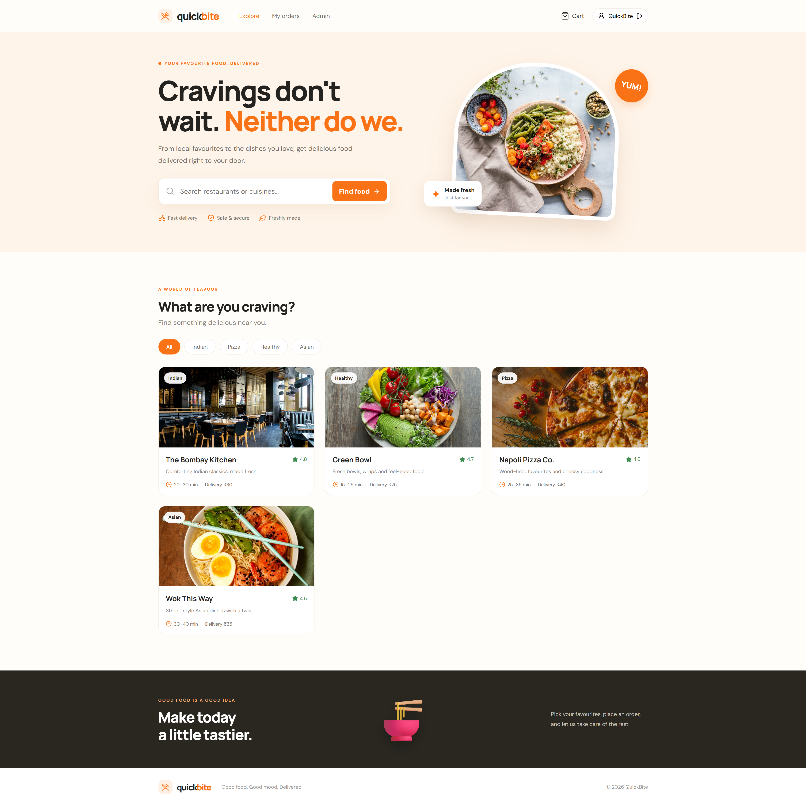
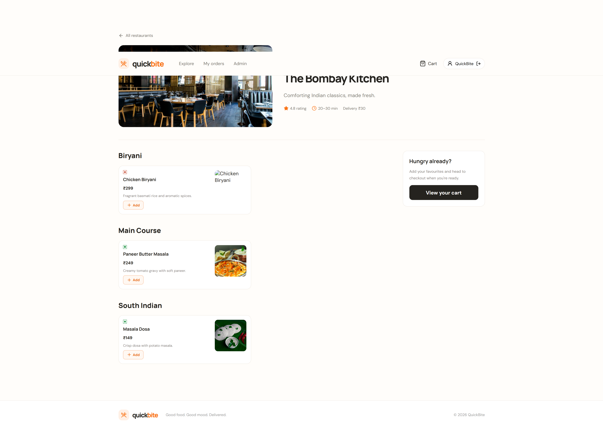
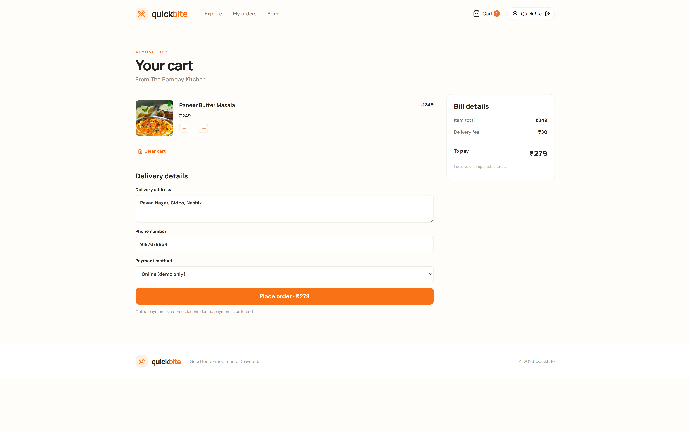
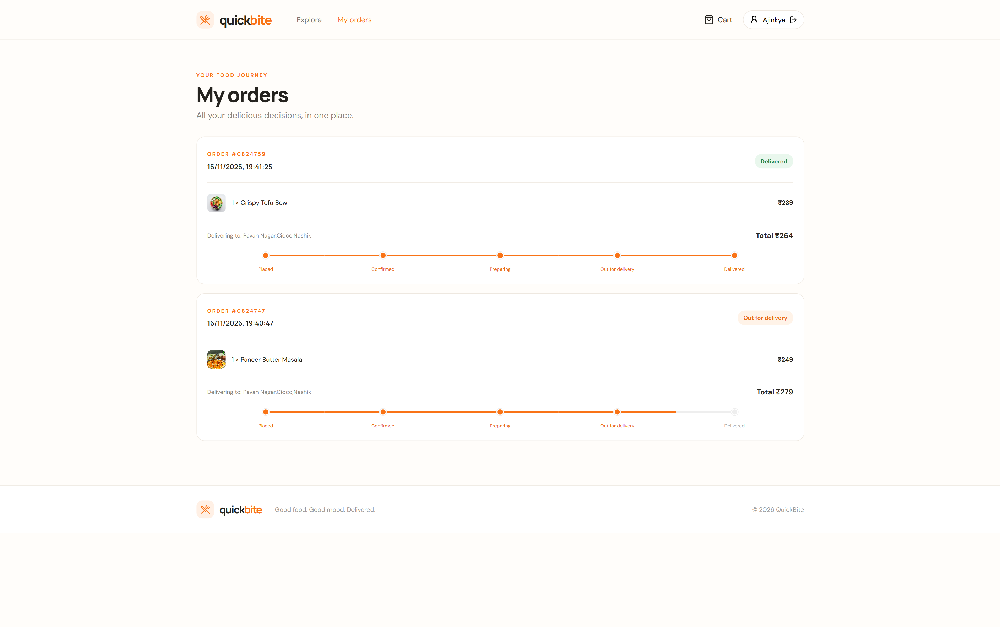
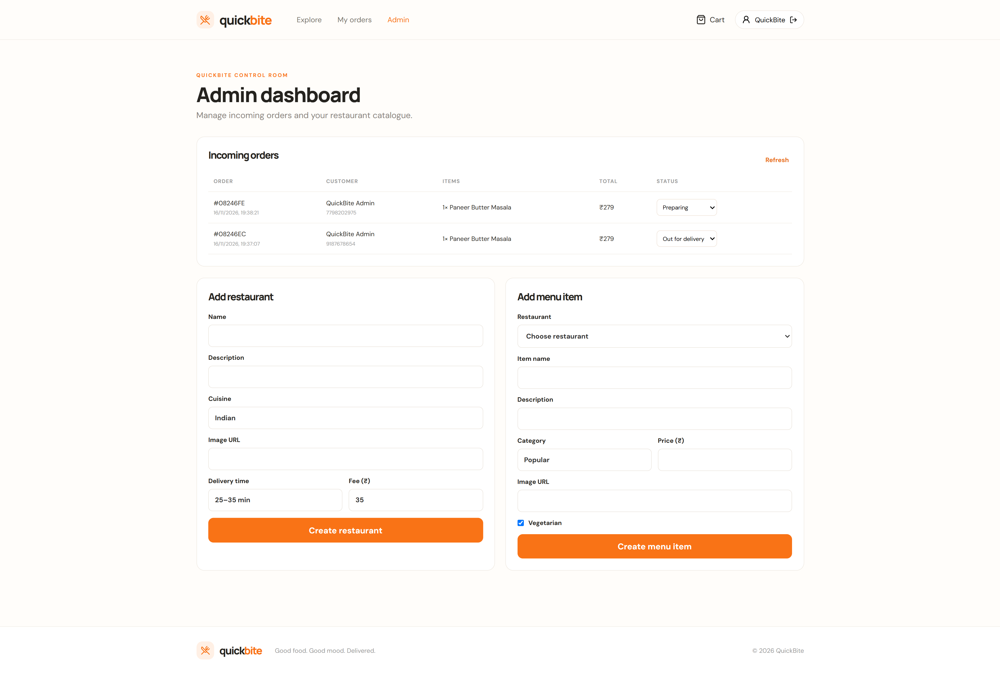

# 🍔 QuickBite – MERN Food Delivery Application

<p align="center">
  
  
  
  
  
  
  
</p>

**QuickBite** is a full-stack food delivery application built using the MERN stack (MongoDB, Express.js, React.js, and Node.js). It provides a seamless food ordering experience where customers can explore restaurants, browse menus, add items to their cart, place orders, and track their order status.

The application also includes an admin dashboard for managing restaurants, menu items, and customer orders.

---

## 📸 Screenshots

<!-- Add your project screenshots inside the screenshots folder -->

### Home Page



### Restaurant & Menu



### Shopping Cart & Checkout



### My Orders



### Admin Dashboard



---

## ✨ Features

### 👤 Authentication

- User registration and login.
- JWT-based authentication.
- Password hashing using bcrypt.
- Protected routes and role-based authorization.

### 🍕 Customer Features

- Browse available restaurants.
- Explore restaurant menus.
- Search and discover food options.
- Add food items to the shopping cart.
- Increase or decrease item quantities.
- Automatic subtotal and delivery fee calculation.
- Checkout and place food orders.
- Select Cash on Delivery.
- View order history.
- Track order status.

### ⚙️ Admin Features

- Dedicated admin dashboard.
- Create and manage restaurants.
- Add menu items.
- View customer orders.
- Update order statuses.
- Manage food delivery operations.

### 📱 UI & Experience

- Responsive user interface.
- Modern food delivery design.
- Reusable React components.
- Client-side routing.
- Centralized application state management.

---

## 🛠️ Tech Stack

| Technology   | Purpose                             |
| ------------ | ----------------------------------- |
| React.js     | Frontend user interface             |
| React Router | Client-side routing                 |
| Context API  | Global state management             |
| CSS3         | Styling and responsive design       |
| Node.js      | Backend runtime                     |
| Express.js   | REST API development                |
| MongoDB      | NoSQL database                      |
| Mongoose     | MongoDB object modeling             |
| JWT          | Authentication                      |
| bcryptjs     | Password hashing                    |
| Axios        | HTTP requests                       |
| Vite         | Frontend development and build tool |

---

## 📂 Project Structure

```text
mern-food-delivery/
│
├── client/
│   ├── public/
│   ├── src/
│   │   ├── components/
│   │   ├── context/
│   │   ├── pages/
│   │   ├── api.js
│   │   ├── main.jsx
│   │   └── styles.css
│   ├── .env.example
│   └── package.json
│
├── server/
│   ├── src/
│   │   ├── config/
│   │   ├── controllers/
│   │   ├── middleware/
│   │   ├── models/
│   │   ├── routes/
│   │   ├── utils/
│   │   ├── seed.js
│   │   └── server.js
│   ├── .env.example
│   └── package.json
│
├── .gitignore
├── package.json
└── README.md
```

---

## ⚙️ Installation & Setup

Follow these steps to run the project locally.

### 1. Clone the Repository

```bash
git clone https://github.com/ajinkya029/mern-food-delivery.git
```

### 2. Navigate to the Project Directory

```bash
cd mern-food-delivery
```

### 3. Install Dependencies

```bash
npm install
npm run install:all
```

### 4. Configure Environment Variables

Create a `.env` file inside the `server` directory using the provided `.env.example` file.

```env
PORT=5000
MONGO_URI=your_mongodb_connection_string
JWT_SECRET=your_secret_key
CLIENT_URL=http://localhost:5173
```

Update the values according to your MongoDB configuration.

### 5. Seed Sample Data

Run the following command to populate the database with sample restaurants and menu items.

```bash
npm run seed --prefix server
```

### 6. Start the Application

Run both frontend and backend servers:

```bash
npm run dev
```

### 7. Open the Application

Frontend:

```text
http://localhost:5173
```

Backend API:

```text
http://localhost:5000
```

---

## 🔐 Demo Admin Credentials

Use the following credentials to access the admin dashboard:

| Field    | Value               |
| -------- | ------------------- |
| Email    | admin@quickbite.dev |
| Password | Admin123!           |

**Note:** These are development demo credentials. Change the password before deploying the application.

---

## 🔗 API Endpoints

### Authentication

| Method | Endpoint             | Description         |
| ------ | -------------------- | ------------------- |
| POST   | `/api/auth/register` | Register a new user |
| POST   | `/api/auth/login`    | Login user          |
| GET    | `/api/auth/me`       | Get current user    |

### Restaurants

| Method | Endpoint               | Description            |
| ------ | ---------------------- | ---------------------- |
| GET    | `/api/restaurants`     | Get all restaurants    |
| GET    | `/api/restaurants/:id` | Get restaurant details |

### Menu

| Method | Endpoint    | Description                |
| ------ | ----------- | -------------------------- |
| POST   | `/api/menu` | Create a menu item (Admin) |

### Orders

| Method | Endpoint                 | Description                 |
| ------ | ------------------------ | --------------------------- |
| POST   | `/api/orders`            | Place a new order           |
| GET    | `/api/orders/my`         | Get customer orders         |
| GET    | `/api/orders`            | Get all orders (Admin)      |
| PATCH  | `/api/orders/:id/status` | Update order status (Admin) |

---

## 💳 Payment Integration

The current application supports Cash on Delivery (COD).

Online payment processing is not yet integrated. A payment gateway such as Razorpay or Stripe can be added to support secure online transactions.

---

## 🚀 Future Improvements

- Online payment gateway integration.
- Real-time order tracking using Socket.IO.
- Delivery partner dashboard.
- Restaurant ratings and reviews.
- Advanced food search and filtering.
- Wishlist and favorite restaurants.
- Email and push notifications.
- Cloud-based image uploads.
- Deployment with production configurations.

---

## 👨‍💻 Author

**Ajinkya Dhatrak**

GitHub: [@ajinkya029](https://github.com/ajinkya029)

---

⭐ If you like this project, consider giving it a star!

**Built with ❤️ using the MERN Stack.**
